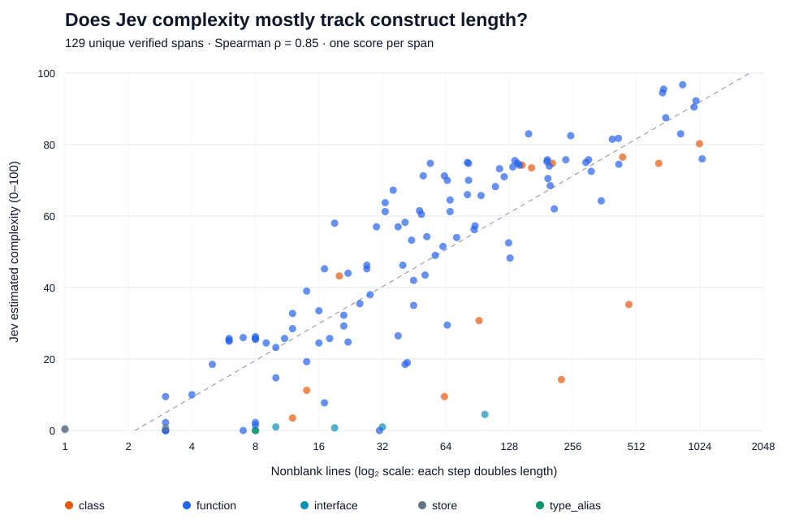

# Verified construct length versus Jev complexity

## Result

**Jev's current cognitive-complexity estimate is strongly associated with construct length.**
The association gets stronger when comparing only functions, rather than mixing declaration kinds.

| Population | Spans | Spearman correlation, nonblank lines | Pearson correlation, nonblank lines | Pearson correlation, log₂ nonblank lines | In-sample variance accounted for by log₂ length |
| --- | ---: | ---: | ---: | ---: | ---: |
| All verified constructs | 129 | 0.849 | 0.603 | 0.831 | 69.0% |
| Functions | 107 | 0.900 | 0.631 | 0.889 | 79.0% |
| Classes | 13 | 0.743 | 0.583 | 0.683 | 46.6% |

Spearman measures whether larger constructs generally receive higher scores; 1 means perfect ordering.
The relationship is not linear in raw line count, which is why Pearson on raw lengths is lower.
For functions, doubling nonblank length is associated with about **10.8 additional complexity points**.
This is a descriptive fit, not a rule or a causal effect.

File-cluster bootstrap 95% intervals for Spearman on nonblank lines:

- All constructs: **0.760–0.898**.
- Functions: **0.842–0.931**.

Total lines give almost the same result: Spearman **0.849 overall**, **0.903 for functions**.
Character counts give **0.850 overall**, **0.911 for functions**.
The within-construct-kind, centered Pearson correlation between log₂ nonblank length and score is **0.860**.
This relationship is not just an artifact of mixing interfaces and functions.



## What Jev distinguishes beyond length

Some functions of similar length receive quite different scores:

| Function | Nonblank lines | Complexity / 100 |
| --- | ---: | ---: |
| `setServerEventWatch` | 19 | 58.0 |
| `principalMetaForComponent` | 17 | 7.8 |
| `planAutoRePin` | 36 | 67.3 |
| `runMaintainAgent` | 41 | 18.5 |
| `acceptSubsystemModelProposal` | 54 | 74.8 |
| `CenteredMessage` | 42 | 19.0 |

Source spot-checks support plausible distinctions: `setServerEventWatch` coordinates mutable
watch state, timers, and cancellation; `runMaintainAgent` mainly forwards arguments and maps
a result; `CenteredMessage` is mostly declarative JSX.
However, this is **not** an independent validation of those exact numeric scores.

The length-only fit leaves a residual RMSE of **12.0 points** for functions.
Residual differences may reflect semantics, model noise, formatting, language, or omitted factors.
This experiment cannot determine how much of each.

## Median scores by nonblank length

| Nonblank lines | Spans | Median complexity / 100 |
| --- | ---: | ---: |
| 1–10 | 26 | 5.9 |
| 11–25 | 20 | 28.9 |
| 26–50 | 21 | 46.3 |
| 51–100 | 21 | 57.3 |
| 101–200 | 17 | 73.8 |
| 201+ | 24 | 76.3 |

## Scope and method

- Inventory: **195 verified model claims**, deduplicated to **129 source spans** across **84 files**.
- Deduplication key: repository, file, start/end lines, content hash. Distinct locations with
  identical source are not automatically merged.
- All 129 spans were readable and their hashes matched. All 129 Jev calls succeeded on the first attempt.
- One score per span, using the exact current `assessConstructComplexity` rubric and source-only
  request from Studio. No source truncation. No source text or API keys saved in the analysis artifacts.
- Every response identified the actual model as **`jev-1.13.0`**.
- Five rubric levels yield a raw score from 0 to 4; normalized and displayed here as 0 to 100.
- Lengths include declaration signatures, comments, and source bodies. “Nonblank” does not mean
  executable lines; comment-only lines remain included.
- Median span: **53 total lines**, **48 nonblank lines**. Total-line range: **1–1,118**.
- Kinds: 107 functions, 13 classes, 4 interfaces, 2 type aliases, 3 stores.
- Repository counts: subsystem-modeling 107, electron-app 10, temporal 6, graphify 3,
  repository-monitoring-server 2, maple 1.
- Only the currently verified catalog was analyzed, not every construct in every checkout.
  The sample is curated and heavily dominated by subsystem-modeling.
- No recorded strict containment between distinct sampled spans was found, so restricting to
  leaf spans does not change the results.
- Confidence: median 0.83; one response below 0.50. Confidence is model-reported, not measured accuracy.
- Usage reported by Jev: **289,909 input tokens**, **2,451 output tokens**.
- Bootstrap: 1,500 whole-file resamples, fixed seed, average ranks for ties. Intervals describe
  variation under file resampling, not model repeatability or correctness.
- Regression results are in-sample. They do not establish performance on unseen repositories.

## Product implication

Length is a strong, free baseline; the present Jev score should not be treated as an independent
importance signal. It does identify some short, stateful functions and long, mostly declarative functions differently.
For PR prioritization, keep **size**, **semantic difficulty**, and **impact/importance** separate.
A useful next experiment would compare Jev against deterministic branching/nesting metrics and
human review judgments, then test whether Jev improves prioritization beyond those cheap baselines.

## Artifacts and reproduction

- `inventory.json`: source identities and duplicate-model references, without source text.
- `results.jsonl`: resumable per-span scores, length metrics, timing, token usage, actual model.
- `constructs.csv`: flat table for exploration.
- `summary.json`: complete numerical output, subsets, confidence intervals, and residual outliers.
- `length-vs-complexity.svg`: vector scatter plot; hover points to see source identities.
- `run.ts`: scores uncached verified spans with concurrency 3 and bounded transient-error retries.
- `analyze.py`: standard-library-only statistics, CSV export, and plot generation.

From the repository root:

```sh
# Calls Jev for uncached spans using Studio's configured key.
bun run analysis/construct-complexity-2026-10-15/run.ts

# Offline; makes no API calls.
python3 analysis/construct-complexity-2026-10-15/analyze.py
```

The cache is scoped to source identity, requested model alias, and a hash of the scoring implementation.
Because aliases can change over time, a future repeat should explicitly pin the model version rather than
silently combine new alias resolutions with this snapshot.
